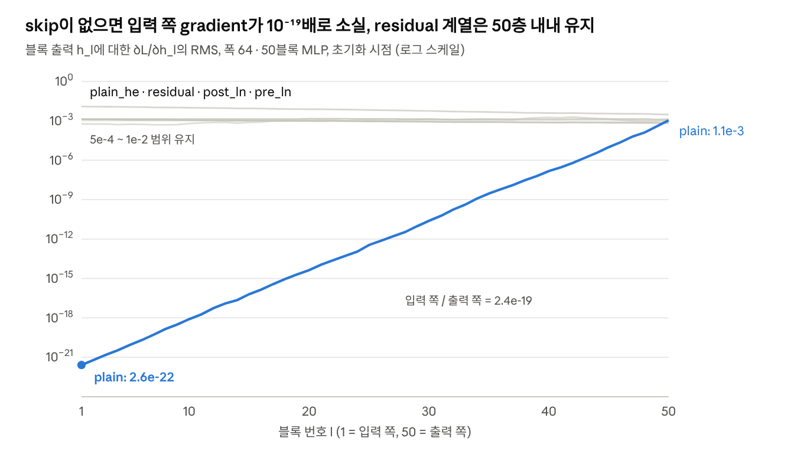
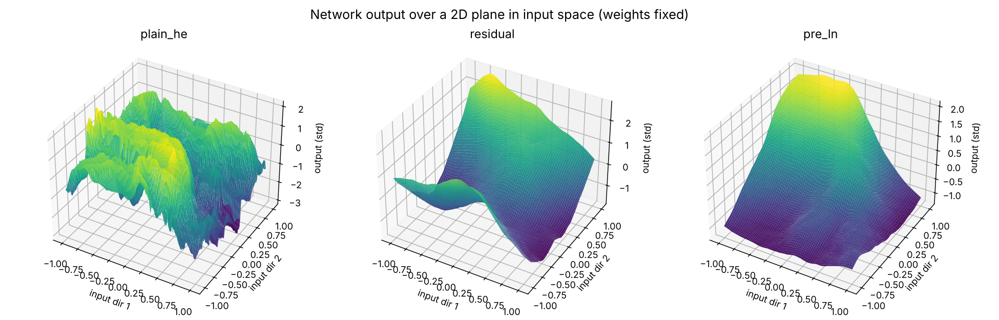
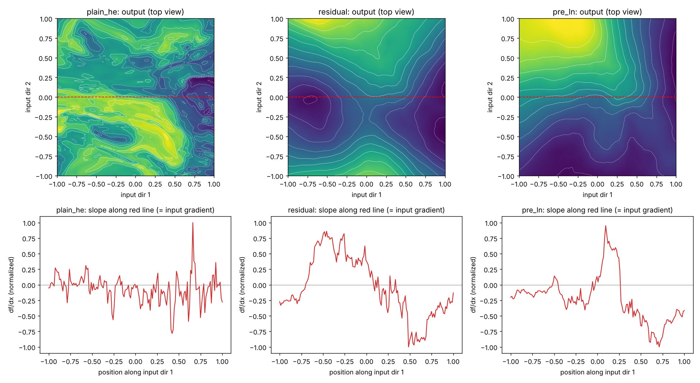
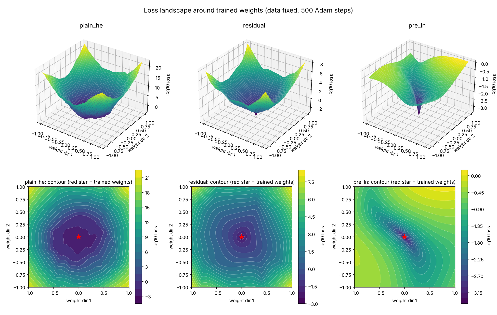
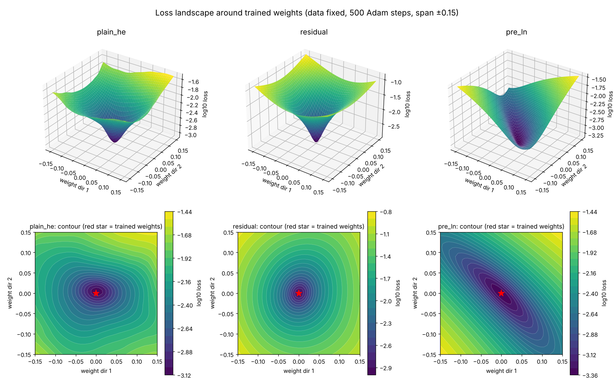

# Residual Connection과 Gradient 소실: 처음부터 정리

Oct 20, 2026 · @Larry

## 개요

Residual connection은 역전파 경로에 항등(identity) 경로를 하나 더 깔아서, gradient가 층을 지나도 크게 줄지 않게 만든다. 실제로 그런지 확인하려면 층별 activation gradient의 크기(norm)와, 방향별로 얼마나 살아남는지(특이값)를 확인하면 된다.

## 1. Activation gradient와 weight gradient

vanishing 여부는 activation gradient로 봐야한다.
$$
\frac{\partial L}{\partial W} = \frac{\partial L}{\partial y} x^T
$$

weight gradient는 뒤에서 전달된 upstream gradient와 이 층의 입력을 곱해서 만들어진다.
- **activation gradient** $∂L/∂h_l$: 출력에서 입력 쪽으로 층을 거쳐 전달되는 신호. 
  소실이란 이 신호가 앞쪽 층에 도착할 때 0에 가까워지는 현상이다.
- **weight gradient** $∂L/∂W_l$: 그 신호가 도착한 층에서 만들어지는 업데이트량.

Residual connection은 activation gradient가 지나가는 길에 우회로를 놓는다. 따라서 activation gradient의 크기가 유지되는지 보면 된다.

| activation grad | weight grad | 해석                                     |
| --------------- | ----------- | -------------------------------------- |
| 앞쪽에서 작음         | 작음          | 진짜 소실. residual이 못 막고 있음               |
| 정상              | 작음          | 신호는 왔는데 층이 못 받아먹음 (입력이 작거나 branch가 포화) |
| 정상              | 정상          | 건강함                                    |

weight gradient는 절댓값보다 $‖∇W‖ / ‖W‖$처럼 가중치 크기 대비 상대값으로 본다.

### 그럼 Activation gradient가 정상적이라는 건 어떻게 아나?

gradient는 `(batch, seq, d)` 같은 큰 텐서라서 층끼리 비교하려면 숫자 하나로 줄여야 한다. 
소실은 크기가 0으로 줄어드는 현상이므로 크기를 재는 L2 norm을 사용한다. 
층마다 $‖g_l‖ / ‖g_{l+1}‖$을 통해 신호가 얼마나 줄었는지 알 수 있다. 이 비율이 일정하게 감소하면, 예를 들어 매 층 0.9배면 50층 뒤에는 0.9⁵⁰ ≈ 0.005가 된다.

다만 크기가 다른 경우에는 RMS(`norm / sqrt(원소 수)`)를 써야한다. norm 자체는 차원 수에 비례해서 커진다. 또한 norm은 크기만 나타낸다. 일부 원소만 큰 경우, 일부 방향만 죽은 경우, 방향이 노이즈처럼 망가진 경우는 norm으로 보이지 않는다.

## 2. Jacobian

Jacobian은 "입력을 살짝 바꾸면 출력이 어떻게 바뀌나"를 모든 입력·출력 조합에 대해 정리한 표다. 
스칼라 미분을 벡터 함수로 확장한 것이다.

$$ J_{ij} = \frac{\partial y_i}{\partial x_j} $$

행이 출력, 열이 입력이다. `J[i][j]`는 "입력 j를 조금 움직였을 때 출력 i가 얼마나 움직이나"
따라서 출력이 행단위로 들어가고 입력이 열 단위로 들어간다. 이 정의는 행/열 표기 관례와 무관하다.

예시:

$$

\begin{aligned}
y_1 &= x_1 x_2 \\
y_2 &= x_1 + 3x_2
\end{aligned}
\quad \implies \quad
J = \begin{bmatrix}
x_2 & x_1 \\
1 & 3
\end{bmatrix}
$$

자주 쓰는 층의 Jacobian은 다음과 같다.

| 함수               | 입력에 대한 Jacobian   | 비고                   |
| ---------------- | ----------------- | -------------------- |
| `y = Wx + b`     | `W`               | bias는 x에 의존하지 않아 사라짐 |
| `y = σ(z)` (원소별) | `diag(σ'(z))`     | 성분마다 따로 적용되므로 대각행렬   |
| `y = σ(Wx + b)`  | `diag(σ'(z)) · W` | 두 단계의 곱              |
| `y = x + F(x)`   | `I + J_F`         | 항등 경로 I가 추가됨         |

`diag(σ'(z))` 항이 고전적인 소실의 주범이다. sigmoid는 σ'의 최댓값이 0.25라서 층마다 최소 4배씩 줄고, ReLU는 살아 있는 성분은 1배로 통과시키지만 죽은 성분(z < 0)은 완전히 끊는다.

코드에서 `diag(v) · g`는 행렬을 만들지 않고 원소별 곱 `v * g`로 계산하는데 사실 diagonal이기 때문에 내적과 같은 말이다.

## 3. 역전파 한 단계: ∂L/∂x = Jᵀ · ∂L/∂y

이 식은 다변수 연쇄법칙을 입력 성분마다 한꺼번에 적은 것이다. 뒤에서 받은 책임(∂L/∂y)을 이 층의 영향력 비율(J)대로 입력들에게 나눠주는 과정이라고 생각하면 된다.

### ∂L/∂y는 무엇인가

이 층의 출력 y를 살짝 바꾸면 loss가 얼마나 변하는지를 성분마다 적은 벡터(upstream gradient)다. 마지막 층에서는 loss를 직접 미분해 얻고(MSE면 `y − target`), 중간 층에서는 바로 뒤 층이 계산한 ∂L/∂x를 그대로 받는다. 층 l의 출력에 대한 이 값이 1절의 activation gradient `∂L/∂h_l`이다.

### 풀어서 계산하기

`J = [[1, 2], [3, 4]]`, 출력 쪽 gradient를 `(a, b)`라 하자. 
x1은 y1과 y2를 거쳐 loss에 닿으므로 경로가 두 개다.
[[Simple Neuron.excalidraw]]


```
∂L/∂x1 = a · ∂y1/∂x1 + b · ∂y2/∂x1 = a·1 + b·3
∂L/∂x2 = a · ∂y1/∂x2 + b · ∂y2/∂x2 = a·2 + b·4
```

**이 입력이 영향을 준 모든 출력에 대해 (출력의 gradient × 그 출력이 이 입력에 얼마나 민감한지(∂y2/∂x1))를 더한다.**

### 깊은 네트워크에서

gradient는 층마다 Jᵀ를 곱하며 앞으로 전달된다.

$$
g_0 = J_1^\top J_2^\top \cdots J_L^\top \, g_L
$$

각 Jᵀ가 벡터를 조금씩 줄이면 곱이 쌓이면서 0으로 수렴한다.

## 4. 행/열 표기, 전치, PyTorch 관례

전치(ᵀ)는 표기 관례 때문에 생긴다. 내가 햇갈리는 부분은 아래 2가지였다.

- **질문 1. J가 W냐 Wᵀ냐?**
- **질문 2. 역전파를 `g · J`로 쓰냐 `Jᵀ · g`로 쓰냐?** 

### 질문 1: J는 W냐 Wᵀ냐

J의 정의는 $x_j$가 변할 때 $y_i$ 변하는 정도이다. 
출력이 행, 입력이 열인 행렬이다. 따라서 W를 생각해봤을 때, 저 gradient가 어디에 위치해있는지를 보면 된다. 예를 들어 W를 (out, in)으로 쓰자. 그러니까 행의 갯수가 output dimension의 수이고 열의 갯수가 input dimension의 갯수라고 하자. 그러면 J의 i,j 포지션은 어디서 올까? $x_j$에 곱해져서 $y_i$에 영향을 주는 숫자일 것이고 이건 W에서 (i,j) 인덱스에 있다. 즉 W를 (out,in)으로 정의하면 J=W 그대로 되는 것이다.
반대로 W를 (in,out)으로 쓰자. 그러면 J의 i,j 포지션 원소는 어디서 올까? 우선 차원을 맞추려면 $y = Wx$가 아니라 $y = x^T W$ 가 되야한다. W가 (in,out)이기 때문에, $x^T$ 가 행벡터라고 생각하고, x랑 W의 열이랑 곱해져야한다. J의 i,j 포지션은 여전히 출력 $y_i$의 입력 $x_j$에 대한 변화량이다. 이 값을 W에서 찾아보면 (j,i)가 된다. 따라서 J는 전치가 된 J = $W^T$이다. 

정리하면 아래와 같다.

| 코드                          | 가중치 모양    | Jacobian |
| --------------------------- | --------- | -------- |
| 수식 `y = Wx`                 | (out, in) | W        |
| PyTorch `y = x @ W.T`       | (out, in) | W        |
| `y = x @ A` (Keras Dense 등) | (in, out) | Aᵀ       |

### 질문 2: 역전파를 `g · J`로 쓰냐 `Jᵀ · g`로 쓰냐?**

두 개가 사실 같은 말이다. 다만 이제 g를 열 벡터로 볼 건지 행 벡터로 볼 건지의 차이다.
g를 행벡터로 본다면 우리가 $\frac{\partial {L}}{\partial{x}}$ 를 계산해낼 때 , 각 x1이 영향을 준 뉴런에 대해서 모두 더해야하기 때문에, J의 열 벡터와 g의 각 원소를 곱해야한다. 따라서 그대로 `g · J`.
g를 열벡터로 본다면 우리가 $\frac{\partial {L}}{\partial{x}}$ 를 계산해낼 때 g를 뒤로 보내는게 편하다. 그럼 앞에 곱해지는 행렬의 행과 곱해져야할 거고 이건 원래 J의 열 요소이다. 따라서 `Jᵀ · g`.

딥러닝 교재가 gradient를 세로로 쓰기 때문에 전치가 붙는 방식이 자연스러움.

### PyTorch는 행벡터 관례

PyTorch는 데이터를 `(batch, features)`로 쌓아 샘플 하나가 한 줄이고, gradient도 (batch, features) 모양으로 나온다. 즉 행 벡터를 여러 개 쌓은 식이다. 
그러면 데이터도 행벡터, gradient도 그에 따라 행벡터로 취급된다. 하지만 이 때까지 우리는 순전파할 때 데이터가 열 벡터이고 y = Wx로 생각해왔다. 하지만 이제 행벡터가 됬기 때문에 $y=x W^T$ 로 하는게 맞다. 그리고 역전파에서는 바로 앞 섹션에서 얘기했듯 `g · J` 로 가고, 현재 W의 차원이 여전히 (out,in) 이기 때문에 J = W이다.

|                 | 순전파 (W의 행 필요) | 역전파 (W의 열 필요) |
| --------------- | ------------- | ------------- |
| 세로 표기 (교재)      | `W · x`       | `Wᵀ · g`      |
| 가로 표기 (PyTorch) | `x · Wᵀ`      | `g · W`       |

`nn.Linear(4, 3)`은 인자가 (in, out) 순서지만 `weight`는 `(3, 4)`, 즉 (out, in)으로 저장된다. 편의상 우리가 사고할 때는 batch는 자동으로 맞춰지고 하나의 샘플에 대해서로 생각하는게 편하기 때문에 수식 `y = Wx`의 W와 같은 모양으로 맞춘 것이다.

```
순전파:  x (batch, 4) @ W.T (4, 3)          → y (batch, 3)
역전파:  grad_y (batch, 3) @ W (3, 4)       → grad_x (batch, 4)
weight:  grad_y.T (3, batch) @ x (batch, 4) → grad_W (3, 4)
```

## 5. 행렬 곱의 두 관점과 W의 의미

W가 (out, in)이면 행 하나는 출력 뉴런 하나에 연결되어있는 선이다. 그 행의 값이랑 곱해지는 모든 값들이 output dimension의 한 원소로 가기 때문이다.반대로 열 하나는 입력 특성 하나에서 뻗어 나가는 선이다. 

여기서 2개의 관점을 가져갈 수 있다.

- **행 관점 (내적)**: 결과의 i번째 값 = W의 i번째 행 · x. 즉 입력 중에서 어떤 부분에 집중하는지 가중치 그 자체이다. 출력 뉴런이 어떤 입력을 주로 보는지에 대한 해석.
- **열 관점 (선형결합)**: W의 열들을과 각 x의 원소 하나를 곱한 것이다. W의 열들은 출력 공간을 span하는 벡터들이다. 이 벡터들을 얼만큼 늘리는지 계수가 곧 x 입력 벡터라는 관점이다. 

$$
Wx = x_1 W_{:,1} + x_2 W_{:,2} + \cdots + x_n W_{:,n}
$$

### 뉴런 관점에서 바라보는 순전파, 역전파

| 계산 (PyTorch)              | 의미                                                                                                                                                               |
| ------------------------- | ---------------------------------------------------------------------------------------------------------------------------------------------------------------- |
| 순전파 `X @ W.T`             | 모든 (샘플, 뉴런) 쌍의 내적 표. `Y[b, i] = x_b · w_i`                                                                                                                       |
| 입력 gradient `G @ W`       | 입력에 대한 gradient는 각 뉴런이 받은 gradient를 가중치로 해서 뉴런 벡터들(W의 열들)을 섞어 입력 쪽으로 돌린다.. $∂L/∂x_b = Σ_i G[b,i] · w_i$                                                          |
| weight gradient `G.T @ X` | 각 weight를 업데이트 해야한다. 각 weight에 대한 gradient는 입력과 출력 뉴런 i가 받은 gradient의 조합으로 계산되어진다. 근데 배치이고 출력 뉴런 i로 들어가는 가중치 행에 대한 계산을 해보자면 다음과 같다. $∂L/∂w_i = Σ_b G[b,i] · x_b$ |

순전파는 각 뉴런이 들어오는 선(행)을 따라 값을 모으고, 역전파는 같은 선을 거꾸로 타서 입력 노드 j로 모인다. $x_j$로 모이는 선은 j에서 뻗어 나갔던 선, 즉 j열이다. 그래서 역전파는 "J의 열과 g의 pairwise 연산"이다.

## 6. Column space, null space, 비선형 활성화
이 부분도 햇갈렸던 부분인데, 이번에 정리하고자 한다.
우리가 흔히 W라고 하면 column space를 정의할 수 있다. 열 벡터가 span할 수 있는 공간인건데, 이게 신경망에서 어떤 의미를 갖는지를 보고자 했다.

W의 열들이 span하는 공간(column space)이 출력 y가 놓일 수 있는 영역이고, x는 그 열들을 섞는 부호 있는 계수다. 열들이 선형독립일 때만 basis가 되고, 그때 x는 그 basis에 대한 좌표다.

| 층                         | 상황                     | 결과                                            |
| ------------------------- | ---------------------- | --------------------------------------------- |
| `Linear(4, 3)` (in > out) | 3차원에 열벡터 4개 → 반드시 선형종속 | 서로 다른 x가 같은 y로 감. <br>최소 1차원(null space)이 사라짐 |
| `Linear(3, 4)` (in < out) | 4차원에 열벡터 3개            | 출력이 4차원 안의 3차원 판에만 놓임                         |

### 비선형 활성화가 출력하는 공간을 휘게 만든다.

`Linear(1, 2)`, `W = [1, -1]ᵀ`이면 `y = (x, -x)`라서 출력이 2차원 평면의 직선 하나 위에만 놓인다. ReLU를 적용하면 x > 0일 때 `(x, 0)`, x < 0일 때 `(0, |x|)`가 되어 출력이 ㄴ자로 꺾인다. 더 이상 직선 하나(선형 부분공간)로 표현되지 않으므로, 다음 층이 두 방향을 따로 다룰 수 있다. ReLU가 없으면 층을 넓혀도 1차원짜리 정보만 흐른다.

### null space 방향은 gradient도 0이다

`Linear(2, 1)`, `W = [1, 1]`이면 `y = x1 + x2`다. x를 `(1, -1)` 방향으로 움직이면 y가 변하지 않으므로 loss도 변하지 않는다. 실제로 gradient는 항상 `Wᵀg = g·(1, 1)` 방향뿐이고 `(1, -1)` 성분은 0이다. 순전파에서 사라진 방향은 역전파에서도 신호가 돌아오지 않는다.

## 7. 특이값: 방향별 배율

특이값은 행렬이 각 방향을 몇 배로 늘리거나 줄이는지를 나타내는 배율이다. 길이 1인 벡터들(원)에 W를 곱하면 타원이 나오고, 타원의 반지름 길이들이 특이값이다.

- 대각행렬 `[[2, 0], [0, 0.5]]`: 가로 2배, 세로 0.5배. 특이값 2, 0.5.
- `W = [1, 1]`: `(1, 1)` 방향 단위벡터는 √2 ≈ 1.41배, `(1, -1)` 방향은 0배. 특이값 0인 방향이 null space다.

### SVD

모든 행렬은 회전 → 축별 늘리기 → 회전으로 쪼갤 수 있다.
$$W = U \, \Sigma \, V^\top$$

회전(U, V)은 길이를 바꾸지 않으므로 길이에 영향을 주는 건 대각행렬 Σ, 즉 특이값뿐이다.

| 특이값    | 그 방향의 gradient       |
| ------ | -------------------- |
| 0      | 완전히 사라짐 (null space) |
| 1보다 작음 | 층을 지날수록 소실           |
| ≈ 1    | 유지                   |
| 1보다 큼  | 층을 지날수록 폭발           |

### norm이 놓치는 것

`W = [[1, 0], [0, 0.1]]`인 층을 10번 지나면 두 번째 방향은 0.1¹⁰배가 되어 소실된다. 하지만 첫 번째 방향이 그대로라 gradient 전체의 norm은 별로 줄지 않아 보인다. norm은 전체 크기 하나만 알려주고, 특이값은 방향별 생존율을 알려준다. 코드로는 `torch.linalg.svdvals(W)`.

## 8. Residual이 소실을 막는 원리

블록 `y = x + F(x)`의 Jacobian은 `I + J_F`다. 신경망 그림으로는 각 $x_i$에서 $y_i$로 가는 가중치 1짜리 직통 화살표를 추가한 것이다. F 쪽 가중치가 작아지거나 활성화가 죽어도 직통 경로로 gradient가 그대로 돌아온다.

$$
\frac{\partial L}{\partial h_l} = \left(I + J_{F_l}\right)^\top \frac{\partial L}{\partial h_{l+1}} = \underbrace{g_{l+1}}_{\text{identity}} + \underbrace{J_{F_l}^\top g_{l+1}}_{\text{branch}}
$$

방향 관점으로는 `I`가 모든 방향을 1배로 유지하려 하므로 특이값이 1 근처에 모이기 쉽다.

### 그래도 소실이 생기는 경우

- **branch가 identity를 상쇄**: `J_Fᵀg`가 `-g`에 가까우면 두 항이 지워진다.
- **덧셈 뒤에 다른 연산**: Post-LN처럼 LayerNorm이 덧셈 뒤에 오면 항등 경로가 매 층 재스케일된다. Xiong et al. (ICML 2020)이 이 구조의 gradient 문제를 분석했다.
- **크기는 유지되나 내용이 망가짐**: gradient가 노이즈처럼 변하는 shattered gradients (Balduzzi et al., ICML 2017).
- **깊이 낭비**: Pre-LN에서는 residual stream norm이 깊이에 따라 커져 뒤쪽 블록의 상대 기여가 줄어든다. gradient는 살아 있어도 깊은 층이 일을 덜 한다.

## 9. 실제로 확인하는 방법

크기(norm), 경로별 분해, 방향(특이값), 질(shattering), 기능(lesion) 순서로 본다. norm만으로 소실 여부 자체는 결론이 난다.

1. **층별 activation gradient norm**: 각 블록 출력에 hook을 걸어 $‖∂L/∂h_l‖$을 깊이에 대해 로그 스케일로 그린다. 입력 쪽으로 직선처럼 떨어지면 지수적 소실이다. skip 없음 / Post-LN / Pre-LN 대조군을 반드시 같이 그린다. weight 쪽은 $‖∇W‖/‖W‖$를 함께 기록한다.
2. **identity 대 branch 분해**: 블록마다 $g_{branch} = J_Fᵀ g$를 `torch.autograd.grad`로 따로 구해 $‖g_{branch}‖/‖g‖$와 cosine을 본다. cos ≈ -1이고 비율 ≈ 1이면 상쇄다. 크기는 비슷한데 방향이 반대이니까. 만약 비율 ≪ 1이면 branch의 Jacobian이 작다는 뜻이고 그건 출력에 대한 입력 gradient가 작다는 것임. 그럼 입력이 어떻게 변해도 그대로 출력을 한다는 뜻이기에 일을 안 하고 있는 것이라 볼 수 있음. 다만 이것도 샘플 하나에 대해서만 통용되는 것이기에 제대로 보려면 전체 샘플에 대한 분포를 보던가 아니면 배치 단위로 학습할 때 Jacobian norm이 모두 작은지를 봐야함. 
3. **Jacobian 특이값**: end-to-end Jacobian $∂h_L/∂h_0$의 특이값이 1 근처에 모이면 괜찮다.(dynamical isometry, Pennington et al., NeurIPS 2017). 
   큰 모델은 `torch.func.vjp`에 랜덤 벡터를 넣어 `‖Jᵀv‖/‖v‖` 분포로 추정한다. e2e jacobian을 다 들고 있으면 메모리 너무 많이 먹음. backward로 돌리면서 d x d 매트릭스를 유지하는게 아니라 d만 유지하고, 랜덤한 g 값을 넣어서 g에 대한 통계값을 잰다.
4. **Shattering**: 입력 x와 x + ε의 `∂L/∂h_0` 상관을 본다. 입력 데이터 지형에서 인접한 부분에 대한 network의 출력에 대한 기울기가 비슷해야한다. 근데 그렇지 않다는 건 비슷한 입력이 비슷한 학습 신호를 주지 않는다는 뜻이고, 이건 배치 상에서 비슷한 샘플을 묶어서 넣어도 학습 gradient의 노이즈가 심해서 학습이 잘 안 될 수 있음을 의미함.
5. **Lesion / 경로 분석**: 학습된 모델에서 블록을 하나씩 `F = 0`으로 꺼 성능 하락을 본다. Veit et al. (NeurIPS 2016)은 ResNet의 gradient가 주로 짧은 경로에서 온다는 것을 이 방식으로 보였다.

### 함정
- **초기화 시점만 보지 말 것**: ReZero, Fixup처럼 branch를 0으로 초기화하면 초기에는 자명하게 `I`다. 학습 중 여러 시점을 본다.
- **fp16 underflow**: loss scaling 문제가 소실처럼 보일 수 있다. fp32로 한 번 확인한다.
- **배치 하나로 판단하지 말 것**: 여러 배치의 중앙값·분위수로 본다.
- **소실이 없다고 학습이 잘 되는 것은 아님**: 2번과 5번이 깊이 낭비를 잡는다.

## 10. 실습 코드와 실행 결과
폭 64, 50블록 MLP에서 skip이 없으면 입력 쪽 activation gradient가 출력 쪽의 2.4×10⁻¹⁹배로 소실되고, residual 계열은 50층 내내 같은 자릿수를 유지했다. 더 흥미로운 결과는 He 초기화를 쓴 plain 망이다. norm은 멀쩡한데 Jacobian의 64개 방향 중 59개가 죽어 있었다. norm만 보면 놓치는 경우를 실제로 재현한 것이다.
코드는 노트북 `residual_gradient_lab.ipynb` 하나이고, Part마다 무엇을 보는지 설명 셀이 붙어 있다. 위에서부터 차례로 실행하면 되고 CPU에서 약 4분 걸린다(대부분 Part 8). 그림과 숫자는 `outputs/` 폴더에도 저장된다.
```

pip install torch matplotlib jupyter

jupyter notebook residual_gradient_lab.ipynb

```

| Part | 내용                                                                        | 대응 절  |
| ---- | ------------------------------------------------------------------------- | ----- |
| 0    | `∂L/∂x = Jᵀg` 검증, `nn.Linear` 저장 모양과 `grad_x = G @ W`, `grad_W = G.T @ X` | 3, 4절 |
| 1    | 층별 activation gradient RMS (5개 구조)                                        | 1, 9절 |
| 2    | identity 대 branch 분해                                                      | 8, 9절 |
| 3    | end-to-end Jacobian 특이값 스펙트럼, VJP 근사                                      | 7절    |
| 4    | null space와 diag(1, 0.1) 장난감 예제                                           | 6, 7절 |
| 5    | Shattering: 이웃 입력 간 gradient 유사도                                          | 9절    |
| 6    | 학습 후 `‖∇W‖/‖W‖`, lesion 실험                                                | 1, 9절 |
| 7    | 입력 공간 지형 (shattering 시각화)                                                 | 11절   |
| 8    | weight 공간 loss 지형                                                         | 11절   |

비교한 구조는 다섯 가지다. `F(h) = W2·relu(W1·h)`.
- `plain`: `h ← relu(Wh)`, PyTorch 기본 초기화
- `plain_he`: 같은 구조, He 초기화(ReLU에 맞춰 norm이 유지되게)
- `residual`: `h ← h + F(h)`
- `post_ln`: `h ← LN(h + F(h))`
- `pre_ln`: `h ← h + F(LN(h))`


plain만 입력 쪽으로 갈수록 직선으로 떨어진다(지수적 소실). 나머지 넷은 이 축척에서 거의 겹칠 만큼 같은 자릿수를 유지한다.
### 구조별 요약 (초기화 시점)

| 구조        | 첫 블록 / 마지막 블록 grad | Jacobian 특이값 중앙값 | 죽은 방향 (특이값 < 0.01) | 이웃 입력 grad cos | 먼 입력 grad cos |
| --------- | ------------------ | ---------------- | ------------------ | -------------- | ------------- |
| plain     | 2.4×10⁻¹⁹          | 8.9×10⁻²⁷        | 64 / 64            | 측정 무의미         | 측정 무의미        |
| plain\_he | 0.56               | 2.1×10⁻⁸         | 59 / 64            | 0.72           | −0.01         |
| residual  | 4.1                | 1.01             | 0 / 64             | 0.994          | 0.43          |
| post\_ln  | 1.00               | 0.35             | 2 / 64             | 0.994          | 0.42          |
| pre\_ln   | 1.90               | 1.03             | 0 / 64             | 0.998          | 0.73          |

### 읽는 법
- **plain**: 크기, 방향 모두 소실. gradient가 10⁻¹⁹ 수준이라 방향 비교(shattering)는 의미가 없다.

- **plain\_he**: 초기화로 norm은 지켰지만 방향은 지키지 못했다. 이웃한 입력끼리도 gradient 방향이 cos 0.72로 어긋나고, 멀리 떨어진 입력끼리는 무관(−0.01)하다. Balduzzi et al.의 shattered gradients가 이것이다.

- **residual (LN 없음)**: 소실은 없지만 입력 쪽 gradient가 4배 커지고 최대 특이값이 15다. 깊어지면 폭발 쪽으로 기운다.

- **post\_ln**: norm은 정확히 평탄(1.00)한데 특이값 중앙값이 0.35로 낮고, 죽은 방향이 정확히 2개다. 확인해 보니 LayerNorm 출력이 움직일 수 없는 평균 방향 (1, 1, …, 1)과 크기 방향(출력 자신)이었다(각각 cos 0.999로 일치). 이 작은 MLP에서는 Post-LN의 학습 불안정이 초기화 시점 norm으로는 드러나지 않는다. 그 문제는 Transformer의 학습 과정에서 주로 보고된다.

- **pre\_ln**: 크기, 방향, 질 모두 가장 건강하다. 특이값이 1 근처에 모여 있다.
### identity 대 branch (Part 2)

  residual 구조에서 블록마다 `‖branch‖/‖identity‖`는 0.19\~0.28, cos는 −0.20\~+0.26이었다. branch가 identity의 5분의 1\~4분의 1 크기로, 상쇄 없이 거의 수직으로 더해진다. 그래서 블록당 통과 배율이 0.98\~1.08이고 50블록 곱이 4.3이 된다. Part 1의 "첫/마지막 = 4.1"과 맞는다.
### 학습 후 (Part 6, pre\_ln 300 step)
- `‖∇W‖/‖W‖`는 앞쪽 블록 0.8\~1.0×10⁻³, 뒤쪽 0.9\~1.6×10⁻³로 깊이 전체에서 같은 자릿수다. 앞쪽 층도 뒤쪽과 비슷한 속도로 학습되고 있다.

- 블록 하나를 꺼도(F = 0) loss는 평균 0.0013 → 0.0021 정도만 오른다. 가장 중요한 블록(1번)을 꺼도 0.0052로, 평균만 예측하는 수준(0.0738)의 7%에 그친다. 하나의 깊은 경로가 아니라 짧은 경로들의 앙상블처럼 동작한다는 Veit et al.의 관찰과 맞는다.
## 11. 지형으로 보기: 입력 공간과 weight 공간
같은 모델이라도 입력 공간 지형은 산산조각 나 있는데 weight 공간 지형은 매끈할 수 있다. plain\_he가 그랬다. 두 지형은 서로 다른 질문에 답한다.

|          | 입력 공간 지형                           | weight 공간 지형 (loss landscape) |
| -------- | ---------------------------------- | ----------------------------- |
| 고정하는 것   | weight                             | 데이터                           |
| 평면을 잡는 곳 | 입력 x                               | weight θ                      |
| 높이       | 네트워크 출력 f(x)                       | loss                          |
| 기울기의 의미  | 입력에 대한 gradient ∂f/∂x              | weight에 대한 gradient ∂L/∂θ     |
| 답하는 질문   | 비슷한 샘플이 비슷한 학습 신호를 주나 (shattering) | 최적화 경로가 매끈한가                  |

고차원 공간은 그대로 그릴 수 없으므로, 기준점에서 랜덤 방향 두 개로 뻗은 평면을 잘라 그린다. 코드는 실습 노트북 Part 7, 8에 있다.
### 입력 공간 지형 (Part 7)
평면 `x(s, t) = x0 + s·d1 + t·d2` 위 점마다 출력을 높이로 그렸다. 위치를 옮기는 것은 다른 샘플로 바꾸는 것이고, 그 지점의 기울기가 입력 gradient다.

plain\_he는 잔주름과 날카로운 골이 가득하고, residual과 pre\_ln은 큰 언덕과 골짜기가 완만하게 이어진다.


아랫줄이 핵심이다. 빨간 선을 따라가며 기울기(입력 gradient)를 그대로 그렸다. plain\_he는 위아래로 튀는 백색잡음이고, residual 계열은 자잘한 떨림 위에 큰 흐름이 보인다. Balduzzi et al.이 논문에서 비교한 그림이 이것이고, Part 5의 cos 숫자(이웃 간 0.72 대 0.99)를 그림으로 본 셈이다.

높이를 loss가 아닌 출력으로 잡은 이유는 연쇄법칙에 있다. MSE면 `∂L/∂x = (f − y) × ∂f/∂x`인데, 앞의 `(f − y)`는 스칼라라서 gradient의 크기와 부호만 바꾸고 방향은 `∂f/∂x`가 정한다. loss로 그리면 평면 위의 인공 입력에 정답을 정할 방법이 없고, 정답과의 대소관계가 바뀌는 곳에서 gradient 부호가 뒤집혀 shattering처럼 보이는 가짜 신호가 섞인다.
### weight 공간 지형 (Part 8)
세 구조를 같은 회귀 문제로 500 step(Adam) 학습한 뒤, 학습된 weight θ\* 주변 평면 `θ* + α·d1 + β·d2` 위에서 데이터 2048개에 대한 loss를 log10으로 그렸다(Li et al., NeurIPS 2018 방식). 랜덤 방향의 각 행을 해당 뉴런 실제 weight의 크기에 맞췄다(filter normalization의 MLP판). 그래서 α = 1은 모든 뉴런을 자기 크기만큼 흔든다는 뜻이다. bias와 LayerNorm 파라미터는 고정했다
  


넓은 범위(±1)에서는 모양보다 폭발 규모가 다르다. 가장자리 loss가 plain\_he 약 10²², residual 약 10⁸, pre\_ln 1.2다. weight를 흔든 변화가 50층에서 곱해지는데, skip이 없으면 그대로 폭발하고 pre\_ln은 LayerNorm이 매 층 크기를 되돌린다.



학습된 지점 근처(±0.15)를 확대하면 세 구조 모두 매끈한 그릇이다. pre\_ln이 비스듬한 계곡 모양인 정도의 차이만 있다.

### 재현되지 않은 것
Li et al.은 skip을 뺀 깊은 망의 loss 지형이 혼돈스럽게 조각난다는 것을 보였지만, 이 실험에서는 재현되지 않았다. plain\_he도 loss 0.0008까지 잘 학습됐다. 설정 차이로 본다.
- Li et al.은 CIFAR-10을 분류하는 56\~110층 CNN이었고, 이 실험은 폭 64 MLP로 쉬운 회귀를 풀었다.
- Adam이 층마다 업데이트 크기를 맞춰 줘서 plain\_he의 어려움을 상당 부분 흡수했을 수 있다.
따라서 이 장난감 설정에서는 shattering이 학습 실패로 이어지지 않았다. "shattering이 있으면 학습이 안 된다"는 더 깊고 어려운 문제에서의 이야기로 받아들인다. 재현하려면 깊이를 늘리거나 SGD를 쓰거나 실제 이미지 데이터로 학습해 봐야 한다.
## 참고 자료
이 문서 작성 중 웹 검색은 하지 않았다. 아래 논문과 자료의 서지 정보는 기억에 의존한 것이므로 인용 전에 원문을 확인할 것.

**논문**
- Veit, Wilber, Belongie. *Residual Networks Behave Like Ensembles of Relatively Shallow Networks*. NeurIPS 2016. (9, 10절, lesion 실험)
- Balduzzi et al. *The Shattered Gradients Problem: If resnets are the answer, then what is the question?* ICML 2017. (shattering)
- Pennington, Schoenholz, Ganguli. *Resurrecting the sigmoid in deep learning through dynamical isometry*. NeurIPS 2017. (Jacobian 특이값)
- Xiong et al. *On Layer Normalization in the Transformer Architecture*. ICML 2020. (Post-LN 대 Pre-LN)
- Li, Xu, Taylor, Studer, Goldstein. *Visualizing the Loss Landscape of Neural Nets*. NeurIPS 2018. (11절, loss landscape와 filter normalization)

**행렬 미분 학습 자료**
- Parr & Howard. *The Matrix Calculus You Need For Deep Learning*. arXiv, 2018. 스칼라 미분에서 Jacobian, 연쇄법칙까지 차근차근 올라간다. 가장 먼저 추천.
- Stanford CS224n 노트 *Computing Neural Network Gradients*. layout 관례(가로/세로)를 명시적으로 다뤄 전치 혼란을 푸는 데 좋다.
- Deisenroth, Faisal, Ong. *Mathematics for Machine Learning*. Cambridge University Press, 2020. 5장 Vector Calculus.
- Petersen & Pedersen. *The Matrix Cookbook*. 공식을 찾아보는 용도.